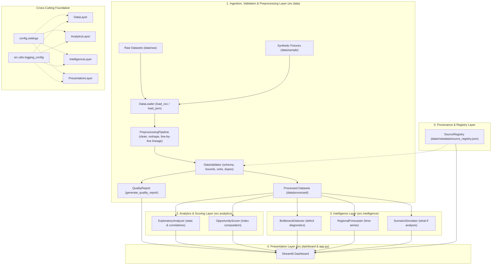

# EconLens AI — System Architecture & Technical Design

## 1. Overview & Vision

**EconLens AI** is an open, evidence-grounded regional economic intelligence platform. It discovers regional economic opportunities, quantifies potential bottlenecks, and provides explainable comparative intelligence across geographic units (such as districts or states).

The architecture is built on five core principles:
1. **Evidence-Grounding:** Findings are strictly derived from verified empirical data.
2. **Anti-Fabrication Guardrails:** The system never silently generates or substitutes fake economic statistics.
3. **Transparent Decomposition:** Opportunity scores and bottleneck findings provide clear, factor-level explanations.
4. **Non-Causal Humility:** The platform distinguishes correlation and comparative ranking from unproven causal claims.
5. **Modular Separation:** Clear boundaries between data engineering, analytics, intelligence, and presentation.

---

## 2. System Architecture & Component Flow

The system is structured as a clean, modular monolith with explicit one-way data and dependency flows.

---

## 3. Data Architecture (Stage 2A Implementation)

Stage 2A establishes the concrete data contracts, loading mechanisms, schema enforcers, and provenance tracking required by future analytical stages.

### 3.1 Canonical Data Schema (`src/data/schema.py`)
- **Long-Form Interchange Standard:** Decouples indicators from table structures.
- **Composite Primary Key:** `(region_id, indicator_code, reference_period)`.
- **Supported Administrative Levels:** `district`, `state`, `block`, `subdistrict`, `national`.
- **Reference Period Standards:** Formats like `YYYY`, `YYYY-YY`, `YYYY-YYYY`, and `QX-YYYY`.
- **Indicator-Specific Bounds:** Domain-specific physical limits (e.g., percentages bounded in $[0.0, 100.0]$).

### 3.2 Dataset Source Registry (`src/data/source_registry.py`)
- Stored as structured JSON in `data/metadata/source_registry.json`.
- Enforces explicit verification lifecycle states: `planned`, `acquired`, `validated`, `rejected`.
- Tracks citations, licensing conditions, geographic coverage, frequency, and update notes.

### 3.3 Reusable Data Loader (`src/data/data_loader.py`)
- Strictly read-only; guarantees original source file immutability.
- Classifies exceptions into actionable categories: `DatasetNotFoundError`, `UnsupportedFormatError`, `EmptyDatasetError`, `MalformedDataError`.
- Supports configurable encodings and isolates storage tiers (`raw`, `processed`, `sample`, `metadata`).

### 3.4 Data Validator (`src/data/validation.py`)
- Validates canonical long-form observations deterministically.
- Audits required fields, missing values, non-finite / unparseable numeric values, reference period patterns, and geographic levels.
- Detects duplicate observation keys without silent dropping.
- Enforces unit consistency per indicator code and flags unregistered source IDs.
- Returns comprehensive `ValidationResult` objects distinguishing fatal errors from informational warnings.

### 3.5 Safe Preprocessing & Lineage (`src/data/preprocessing.py`)
- Standardizes column headers into snake_case and trims text cell whitespace.
- Coerces numeric fields while auditing non-numeric entries.
- Normalizes reference periods.
- Converts wide-form government tables into canonical long-form format (`wide_to_long_observations`).
- **Strict Anti-Imputation Policy:** Missing values are never silently replaced with zero or imputed without an explicit, disclosed rule.
- Generates a `CleaningReport` tracking all transformations applied.

### 3.6 Data Quality & Readiness Reporting (`src/data/quality_report.py`)
- Evaluates dataset completeness, distinct geographic entities, indicator coverage, and missingness distributions before data enters downstream analysis.
- Generates structured dictionary and Markdown diagnostic dossiers.

### 3.7 Real Dataset Acquisition & Adapter Architecture (Stage 2B Implementation)
- **Source Adapters (`src/data/adapters/`):** Decoupled publisher-specific parsers inheriting from `BaseSourceAdapter`:
  - `CensusTNAdapter`: Parses Census 2011 Primary Census Abstract into population, literacy, and WPR observations.
  - `UdyamTNAdapter`: Parses Udyam Registration tables into Micro, Small, Medium, and Total enterprise metrics.
  - `BankingTNAdapter`: Parses RBI / SLBC Lead Bank Scheme reports into Credit, Deposit, and C-D ratios.
  - `InfrastructureTNAdapter`: Parses TN DoES statistical tables into surfaced road length and road density.
  - Every adapter returns an `AdapterResult` capturing canonical observations and explicitly auditing any rejected rows.
- **Audited Network Fetcher (`src/data/acquisition/fetcher.py`):**
  - Enforces mandatory SSL certificate verification (CA check).
  - Implements configurable timeouts (default 15s) and user-agent attribution.
  - Saves downloaded raw files immutably to `data/raw/` and records SHA-256 provenance hashes.
- **Inventory & Coverage Reporting (`src/data/inventory.py`):**
  - Generates machine-readable `data/metadata/data_inventory.json`.
  - Generates human-readable `data/metadata/data_coverage_report.md` documenting geographic coverage (32 Tamil Nadu districts), indicator taxonomy, and boundary harmonization guidelines (ADR 010).
- **Reproducible Pipeline Orchestrator (`src/data/pipeline.py` & `scripts/manage_data.py`):**
  - Centralized CLI commands: `status`, `acquire`, `validate`, `standardize`, `report`, `all`.

### 3.8 Exploratory Data Analysis & Analytical Pipeline (Stage 3 Implementation)
- **Modular Analysis Engine (`src/analytics/exploratory_analysis.py`):**
  - Dataset overview and completeness metrics (`compute_dataset_overview`).
  - Comprehensive quality audits: missingness, non-finite values, duplicate keys (`compute_data_quality`).
  - Parametric and non-parametric indicator distributions: mean, median, std, min, max, quartiles, IQR (`compute_indicator_statistics`).
  - Region-by-region comparative rankings with group average delta calculations (`compute_regional_rankings`).
  - Disparity profiling: highest and lowest observed values, regional spread, and disparity ratios (`compute_regional_comparisons`).
  - Longitudinal readiness and temporal coverage audits (`compute_time_series_availability`).
  - Pairwise bivariate correlation matrices with explicit sample sizes ($N$) and non-causal disclosures (`compute_indicator_correlations`).
- **Dark-Themed Chart Generators (`src/analytics/eda_charts.py`):**
  - Publication-grade Plotly visualizations using the platform's dark telemetry theme (`#0f1117`, cyan/teal accents).
  - Horizontal bar rankings with group mean benchmark lines.
  - Box plots, distribution histograms, scatter plots with regression trend lines, correlation heatmaps, and missingness maps.
- **Reproducible Output Generators (`src/analytics/eda_report.py` & `scripts/run_eda.py`):**
  - Generates machine-readable `data/processed/eda_summary.json`.
  - Generates cross-sectional regional indicator wide table `data/processed/regional_summary_tn.csv`.
  - Generates narrative markdown report `docs/EDA_REPORT.md`.

---

## 4. Module Responsibilities Across Layers

### `config/`
* **`settings.py`**: Centralized configuration management using immutable dataclasses and environment variable resolution. Provides cross-platform `pathlib.Path` resolutions and directory lifecycle management.

### `src.utils/`
* **`logging_config.py`**: Idempotent logger setup with console and file handlers, structured formatting, and exception traceability without leaking sensitive information.

### `src.data/`
* **`schema.py`**: Canonical schema definitions, required/optional columns, primary key definitions, and bounds constraints.
* **`source_registry.py`**: Dataset provenance model and verification state tracking.
* **`data_loader.py`**: Safe dataset discovery and format-aware loading across storage tiers.
* **`validation.py`**: Schema enforcement, primary key duplicate detection, unit consistency, and bounds verification.
* **`preprocessing.py`**: Column standardization, text trimming, numeric coercion, wide-to-long reshaping, and lineage reporting.
* **`quality_report.py`**: Data quality summary metrics and markdown diagnostic reporting.

### `src.analytics/`
* **`exploratory_analysis.py`**: Univariate and multivariate summary statistics, regional disparity metrics, and correlation profiling with non-causal disclosures.
* **`opportunity_scoring.py`**: Multi-dimensional composite opportunity index computation (infrastructure, workforce, business dynamism, socioeconomic) with factor decomposition.

### `src.intelligence/`
* **`bottleneck_detection.py`**: Benchmark-relative deficit detection (e.g., infrastructure bottlenecks, skilling mismatches) tied directly to empirical indicators.
* **`forecasting.py`**: Longitudinal time-series projections with explicit confidence intervals and stated modeling assumptions.
* **`scenario_analysis.py`**: Interactive what-if policy and capital investment shock simulations, explicitly labeled as hypothetical mathematical models.

### `src.dashboard/`
* **`layout.py`**: Page configuration, sidebar navigation, custom dark-oriented CSS styling, headers, and footers.
* **`components.py`**: Reusable UI widgets, transparency banners, module status badges, and welcome states.

---

## 5. Module Boundaries & Non-Circular Import Policy

To guarantee long-term maintainability, the project strictly adheres to hierarchical dependency rules:
1. `config` and `src.utils` are leaf foundational modules; they must never import from `src.data`, `src.analytics`, `src.intelligence`, or `src.dashboard`.
2. `src.data` handles data normalization and validation; it does not depend on analytics or UI modules.
3. `src.analytics` and `src.intelligence` consume processed data structures and produce analytical results; they do not import UI modules.
4. `src.dashboard` and `app.py` consume analytics, intelligence, and data metadata for visualization; they do not perform raw data manipulation or model training directly.
5. All modules use explicit, absolute package imports (e.g. `from config.settings import get_settings`).
