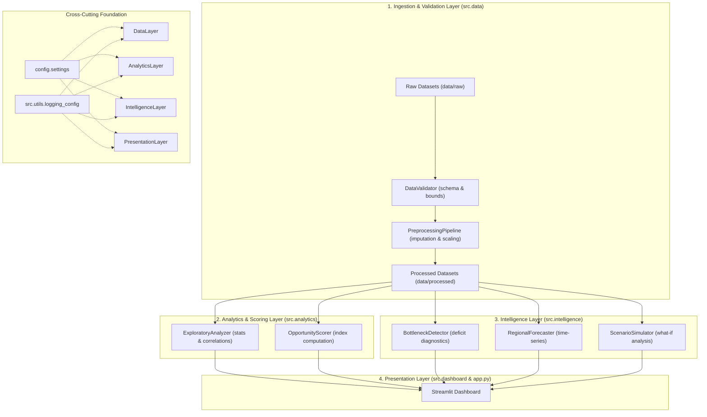

# EconLens AI — System Architecture & Technical Design

## 1. Overview & Vision

**EconLens AI** is an open, evidence-grounded regional economic intelligence platform. It discovers regional economic opportunities, quantifies potential bottlenecks, and provides explainable comparative intelligence across geographic units (such as districts or states).

The architecture is built on five core principles:
1. **Evidence-Grounding:** Findings are strictly derived from verified empirical data.
2. **Anti-Fabrication Guardrails:** The system never silently generates or substitutes fake economic statistics.
3. **Transparent Decomposition:** Opportunity scores and bottleneck findings provide clear, factor-level explanations.
4. **Non-Causal Humility:** The platform distinguishes correlation and comparative ranking from unproven causal claims.
5. **Modular Separation:** Clear boundaries between data engineering, analytics, intelligence, and presentation.

---

## 2. System Architecture & Component Flow

The system is structured as a clean, modular monolith with explicit one-way data and dependency flows.

---

## 3. Module Responsibilities

### `config/`
* **`settings.py`**: Centralized configuration management using immutable dataclasses and environment variable resolution. Provides cross-platform `pathlib.Path` resolutions and directory lifecycle management.

### `src.utils/`
* **`logging_config.py`**: Idempotent logger setup with console and file handlers, structured formatting, and exception traceability without leaking sensitive information.

### `src.data/`
* **`data_loader.py`**: Dataset registry, discovery across storage tiers (`raw`, `processed`, `sample`), and strict isolation of synthetic demonstration data.
* **`validation.py`**: Schema enforcement, geographic boundary verification, indicator range checks, and structured `ValidationResult` generation.
* **`preprocessing.py`**: Missing data imputation, geographic normalization, statistical scaling, and reproducible feature transformation.

### `src.analytics/`
* **`exploratory_analysis.py`**: Univariate and multivariate summary statistics, regional disparity metrics, and correlation profiling with non-causal disclosures.
* **`opportunity_scoring.py`**: Multi-dimensional composite opportunity index computation (infrastructure, workforce, business dynamism, socioeconomic) with factor decomposition.

### `src.intelligence/`
* **`bottleneck_detection.py`**: Benchmark-relative deficit detection (e.g., infrastructure bottlenecks, skilling mismatches) tied directly to empirical indicators.
* **`forecasting.py`**: Longitudinal time-series projections with explicit confidence intervals and stated modeling assumptions.
* **`scenario_analysis.py`**: Interactive what-if policy and capital investment shock simulations, explicitly labeled as hypothetical mathematical models.

### `src.dashboard/`
* **`layout.py`**: Page configuration, sidebar navigation, custom dark-oriented CSS styling, headers, and footers.
* **`components.py`**: Reusable UI widgets, transparency banners, module status badges, and welcome states.

---

## 4. Module Boundaries & Non-Circular Import Policy

To guarantee long-term maintainability, the project strictly adheres to hierarchical dependency rules:
1. `config` and `src.utils` are leaf foundational modules; they must never import from `src.data`, `src.analytics`, `src.intelligence`, or `src.dashboard`.
2. `src.data` handles data normalization and validation; it does not depend on analytics or UI modules.
3. `src.analytics` and `src.intelligence` consume processed data structures and produce analytical results; they do not import UI modules.
4. `src.dashboard` and `app.py` consume analytics and intelligence outputs for visualization; they do not perform raw data manipulation or model training directly.
5. All modules use explicit, absolute package imports (e.g. `from config.settings import get_settings`).

---

## 5. Extensibility & Future Stages

New indicators, scoring dimensions, or intelligence algorithms are added by:
1. Registering the dataset schema in `docs/DATA_DICTIONARY.md`.
2. Implementing the validator in `src.data.validation`.
3. Adding the transformation step in `src.data.preprocessing`.
4. Extending the scoring/bottleneck contracts in `src.analytics` or `src.intelligence`.
5. Exposing the visualization component in `src.dashboard`.
